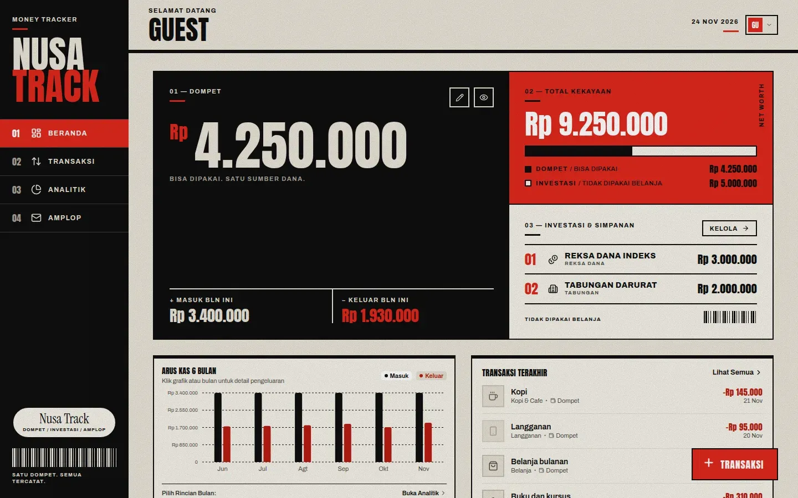
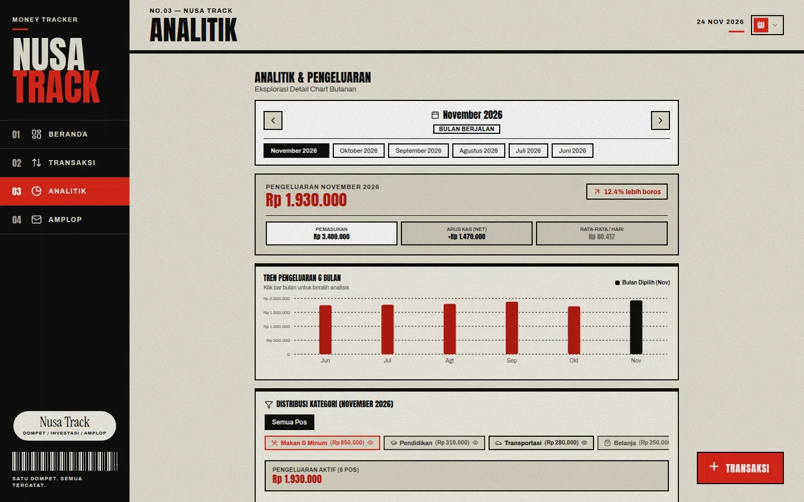
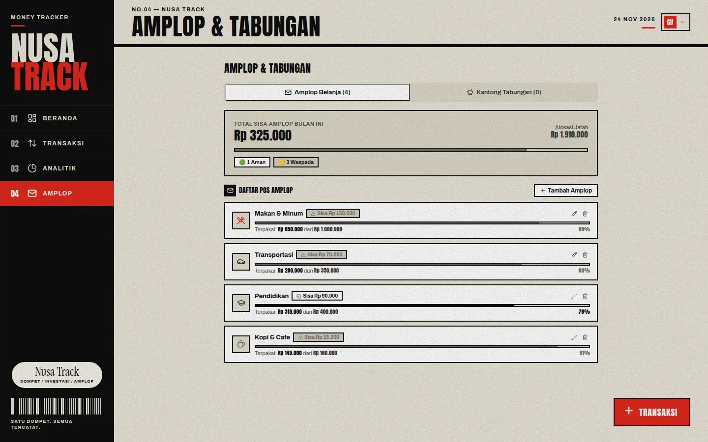

# Nusa Track

A personal finance tracker: one spendable wallet, investments kept separate, and monthly budget envelopes. The interface is in Indonesian.

**Live:** https://budget-track-chi.vercel.app (choose **Masuk Mode Demo** to try it without an account)



| Analytics | Budget envelopes |
|---|---|
|  |  |

All numbers in the screenshots are sample data.

## What it does

- Records income, expenses and transfers into investments, with categories, notes and search.
- Separates money you can spend from money you have invested, and adds them up as net worth.
- Compares spending over six months and breaks each month down by category. Categories can be left out of the totals.
- Tracks budget envelopes and warns from 80% of the limit.
- Keeps savings goals with a target amount.
- Works on phone and desktop.

## How it works

- **State:** one [Zustand store](src/store/useStore.js), persisted to localStorage. Changes show immediately and are then written to Supabase.
- **Demo mode:** uses the same store but never writes to the database.
- **Data access:** each table's queries are in [src/lib/db.js](src/lib/db.js).
- **Security:** every table has row level security, so a user can only read and change their own rows. See [supabase_schema.sql](supabase_schema.sql).
- **Design:** black, paper and red with poster-size numbers. The rules are in [style.md](style.md).

**Stack:** React 19, Vite, Zustand, Supabase (Auth and Postgres), Recharts, Framer Motion.

## Run it locally

```bash
npm install
npm run dev
```

To use your own database, run `supabase_schema.sql` in the Supabase SQL editor and create `.env.local`:

```
VITE_SUPABASE_URL=https://your-project.supabase.co
VITE_SUPABASE_ANON_KEY=your-publishable-key
```

## Known limits

- If a write to Supabase fails, the change stays on the device and is not retried.
- Only the wallet calculations have automated tests (`npm test`).
